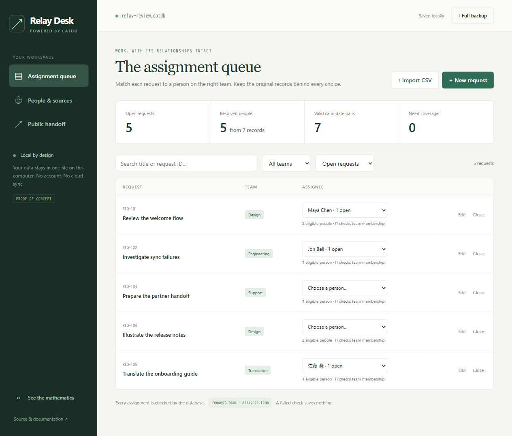

# CatDB

**Make your database do the connecting.**

Merge records, find compatible choices, and reshape data for sharing with one
mathematical foundation. CatDB is an embedded Haskell database where schemas
are categories and checked schema maps induce views, quotients and compatible joins.
Your data live in one native `.catdb` file. No database service or SQLite dependency.

**Working proof of concept · MIT · contributions through issues only**

[Website](https://m-simplifier.github.io/catdb/) ·
[公式サイト（日本語）](https://m-simplifier.github.io/catdb/ja/) ·
[Download](https://github.com/M-simplifier/catdb/releases/tag/v0.2.0-poc) ·
[日本語ガイド](docs/guide.ja.md) · [Limits](STATUS.md) · [Mathematics](docs/mathematics.md) · [Native catalogs](docs/native-memory.md)

## Start with a real application

**Relay Desk** reconciles CSV rosters, assigns requests to people on the right
team, and exports a public handoff. It is a local, single-user application
backed by this library—not a browser simulation or hardcoded result.



Extract the Windows release and double-click `Start Relay Desk.cmd`, or run:

```powershell
.\relay-desk.exe desk.catdb --demo
# Open http://127.0.0.1:4283
```

Omit `--demo` for a blank workspace. Existing files reopen without reseeding.
Stop with Ctrl+C. Restore a full backup by launching the app with the downloaded
`.catdb` file as its first argument. Parent directories must already exist.

Try this workflow:

1. **People & sources:** six records are five people. Maya's equal email
   addresses identify her two records; both original names remain inspectable.
2. Link **Jon B.** and **Jon Bell**. Six records become four people, and the
   Engineering request has one candidate. Remove the link to reverse it.
3. **Assignment queue:** pick an eligible assignee. The database rejects a
   cross-team assignment even when it comes from another caller.
4. Import a CSV roster (`name,email,team`, optional `id`) or requests
   (`id,title,team`). Map differently named columns in the dialog. A Translation
   member fills the uncovered request. Examples are in `samples/`.
5. **Public handoff:** export open requests and assigned source display names
   as CSV or structured JSON. Email/source fields, closed work, and unused names
   are absent. **Full backup** separately includes all private data.

Source name + ID identify roster rows. Reimport updates them atomically. Optional
replacement removes absent rows unless assignments or links still reference
them: unassign/unlink first. Equal email addresses are an application policy;
review collisions. Display names prefer the longest source name; assignments
retain a particular team-compatible source record. Requests support creation,
editing, closing, reopening, deletion, search, and team filters.

## What the category theory buys

Conventional databases can implement this workflow too. CatDB explores whether
**one model of schema translation** makes these operations easier to specify,
inspect and compose.

| Operation | General meaning | Relay Desk use |
|---|---|---|
| `delta f` (Δ) | Precompose with a schema map | Read paths into a public schema |
| `sigma f` (Σ) | Left Kan extension: quotient transported elements | Resolve identities, retaining origins |
| `piMigration f` (Π) | Right Kan extension: compatible families | Enumerate memberships and requests agreeing on team |
| `generated roots` | Least subfunctor containing roots | Trim values unreachable from the public handoff |

For a checked schema map `F : C → D`, the migrations satisfy **Σ_F ⊣ Δ_F ⊣ Π_F**.
The API includes natural transformations, units/counits, `sigmaFactor`,
`piFactor`, and witnesses: the universal properties are callable, not just names.
The app uses different schema maps for different tasks. Its person/team
membership table is application assembly; Π constructs the compatible families.
It does not optimize assignments. Δ alone is not a privacy filter; explicit
root selection and reachability are essential.

## Embed it

Use `import CatDB` and add this directory as a local Cabal package. `Schema`,
`Instance`, `Mapping`, and `Natural` are abstract checked types. Schemas are
runtime values, not type-level Haskell indices.

```haskell
-- Pure transformations; mappings and roots are application values.
public <- delta publicMapping workspace
handoff <- generated visibleRoots public
resolved <- sigma identityMap roster
candidates <- piMigration eligibilityMap memberships

-- A pure callback inside a durable transaction.
result <- transaction db $ \current -> do
  next <- edit changes current
  pure ((), next)
```

See the [complete runnable example](examples/Embedded.hs),
[reference model](reference/src/Relay/Model.hs), and [API contract](docs/api.md).

```sh
cabal run embedded-example -- example.catdb
cabal run catdb -- demo tasks.catdb
cabal run catdb -- todo tasks.catdb add milk home alice "Buy milk"
cabal run catdb -- todo tasks.catdb list
cabal run catdb -- query tasks.catdb delta examples/public-view.json cards.catdb
```

## Build

Release baseline: GHC 9.6.7, Cabal 3.12. Windows: `./build.ps1 -Test`.
The result is `build/relay-desk.exe`, `build/catdb.exe`, and `build/relay-web/`.
With Cabal on Linux or Windows:

```sh
cabal update
cabal build all
cabal test laws --test-show-details=direct --test-options=build/test-data
cabal run relay-desk -- desk.catdb --demo --assets reference/web
```

Use a fresh directory for each manual test run. Warp is pinned to 3.4.12:
3.4.13's receive wait stalled on the tested GHC/Windows runtime. The database
library has no Warp dependency. See [verification](docs/verification.md).

## Deliberate limits

Finite **acyclic** schemas, in-memory data, one exclusive connection, bounded
migrations. No SQL, disk indexes, remote service, encryption, or automatic
format upgrades. This is not a drop-in SQLite replacement or a production
maturity claim. [STATUS.md](STATUS.md) describes the exact boundary.

Original code, UI and website: [MIT](LICENSE). Binary dependencies retain their
own licenses, including GMP; releases include notices and corresponding source.
See [licensing](docs/licensing.md).

Open an [issue](https://github.com/M-simplifier/catdb/issues) with a bug, real
use case or mathematical counterexample. **External PRs are not accepted.**
[Contribution policy](CONTRIBUTING.md).

Theory: David Spivak's [Functorial Data Migration](https://arxiv.org/abs/1009.1166).
[CQL](https://categoricaldata.net/CQL/) is prior work. This is an independent,
deliberately smaller implementation and includes no CQL source code.
